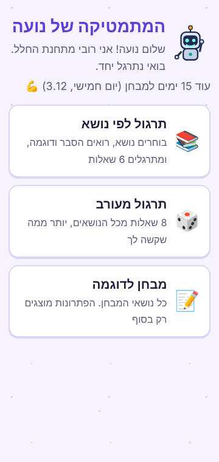
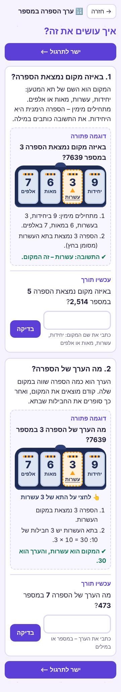
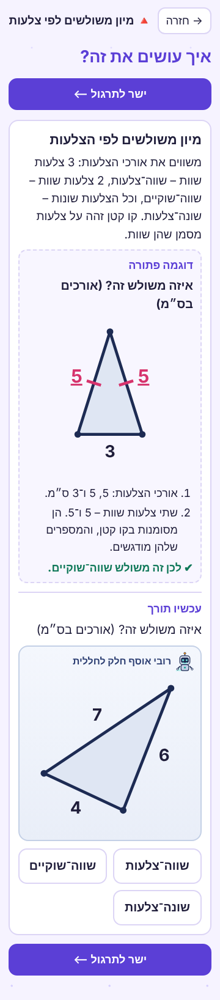
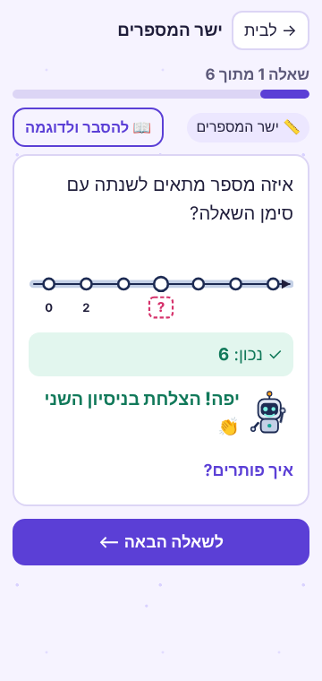
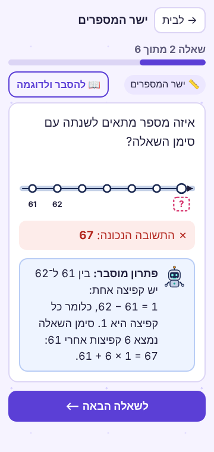
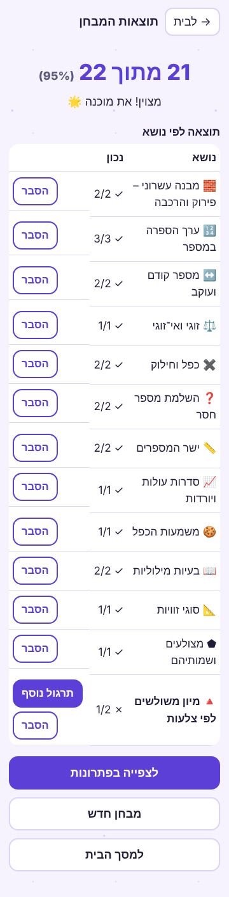
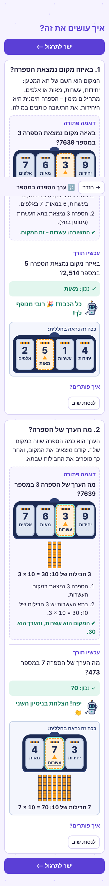
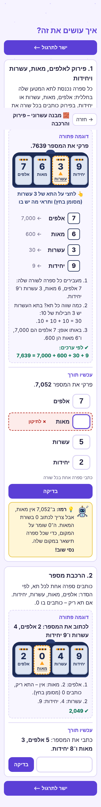
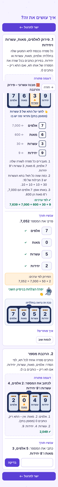

# המתמטיקה של נועה

אפליקציית תרגול במתמטיקה לכיתה ג׳, לקראת המבחן ביום חמישי, 3.12.2026.
האפליקציה בנויה לתרגול עצמאי בטלפון (נבדקה ברוחב 360px), בעברית ובלשון נקבה.
אין בה חשבון משתמש, שרת או טיימר. ההתקדמות נשמרת בזיכרון של הדפדפן (`localStorage`).

> הפרויקט נמצא בתיקייה `noa-math/` של הריפו `havad-daat`. הריפו הזה **אינו** Noa’s English World.
> יש בו רק את `index.html` של אתר אחר, ולא נגעתי בו.

## הפעלה

```bash
cd noa-math
npm install
npm run dev        # שרת פיתוח, גם ברשת המקומית: http://<כתובת-המחשב>:5173
npm run build      # בדיקת TypeScript ובנייה לתיקייה dist/
npm run preview    # הגשת dist/ בכתובת http://localhost:4173
npm test           # בדיקות יחידה (Vitest)
npm run e2e        # בדיקה בדפדפן אמיתי ברוחב טלפון (צריך build קודם)
```

**כדי לפתוח בטלפון של נועה:** מעלים את תיקיית `dist/` לאחסון סטטי כלשהו, כמו GitHub Pages, Netlify Drop או Cloudflare Pages.
הבנייה משתמשת בנתיבים יחסיים (`base: './'`), ולכן היא עובדת גם מתוך תת־תיקייה.
אפשרות אחרת: להריץ `npm run dev` במחשב ולפתוח את הכתובת מהטלפון כששניהם באותה רשת Wi‑Fi.
בדפדפן של סמסונג או בכרום אפשר לבחור ״הוספה למסך הבית״, והאפליקציה תיפתח כמו אפליקציה רגילה.

## מה יש באפליקציה

- **מסך פתיחה:** הכותרת ״המתמטיקה של נועה״, ספירה לאחור למבחן ושלוש דרכי התרגול.
  אם נשאר סבב פתוח, מופיע כפתור ״להמשיך מאיפה שעצרת״, וגם כפתור להמשך המבחן לדוגמה.
- **כרטיס ״איך עושים את זה?״ לכל נושא:**
  - הסבר של עד שלושה משפטים.
  - דוגמה פתורה בשניים־שלושה צעדים.
  - בישר המספרים, במשמעות הכפל ובגיאומטריה יש איור, ובו מסומן בדיוק על מה להסתכל: קשתות קפיצה, חץ בטבלת המקומות, מספור קבוצות, פינת דף מקווקוות, צלעות ממוספרות, אורכים מודגשים וסימוני שוויון.
  - שאלת ״עכשיו תורך״ עם נתונים אחרים: רמז ממוקד, ניסיון נוסף, ואם צריך פתרון מוסבר.
  - בנושאים עם שתי מיומנויות יש דוגמה ותרגול לכל מיומנות: כפל/חילוק, עוקב/קודם, פירוק/הרכבה, וגורם חסר בכפל/השלמה בחילוק.
  - הכפתור ״ישר לתרגול״ מופיע כבר בראש הכרטיס.
- **תרגול לפי נושא:**
  - 6 שאלות, מהקלות למאתגרות (רמות 1, 1, 2, 2, 3, 3), שאלה אחת בכל מסך, ומעליהן ״שאלה 3 מתוך 6״.
  - אחרי טעות ראשונה מופיע רמז והזדמנות לנסות שוב. אחרי טעות שנייה מוצגת התשובה הנכונה ופתרון מוסבר.
  - הכפתור ״להסבר ולדוגמה״ פותח את הכרטיס, וחוזר בדיוק לאותה שאלה.
- **תרגול מעורב:**
  - 8 שאלות, לפחות 2 בגיאומטריה ולפחות 3 בחשבון.
  - נושאים שבהם נועה טעתה (בתרגול או במבחן) מקבלים עדיפות, ונושא חלש יכול להופיע פעמיים. תמיד יש גם שאלות מנושאים אחרים.
  - כפתור ״להסבר״ זמין בכל שאלה.
- **מבחן לדוגמה:**
  - 21 שאלות שמכסות את כל 13 סעיפי המורה. סעיפים מרכזיים מופיעים פעמיים.
  - אפשר לעבור בין השאלות בכפתורים הממוספרים ולתקן תשובות.
  - אין רמזים או פתרונות עד ההגשה, ולפני ההגשה יש אישור.
  - בסוף מוצגת תוצאה לפי נושא. ליד נושא עם טעויות יש ״תרגול נוסף״, וליד כל נושא קישור ״הסבר״. יש גם מסך פתרונות מלא.
- **סוגי שאלות:** הזנת מספר (מקלדת מספרית, `inputmode="numeric"`), בחירה מתוך תשובות, ובחירה מתוך איורים.
  בבעיות מילוליות נועה בוחרת קודם את התרגיל המתאים, ואחר כך כותבת את התשובה.
- **כיוון:** הממשק מימין לשמאל.
  כל תרגיל חשבון, סדרה, ישר מספרים וטבלת מקומות מוצג משמאל לימין, וזה נבדק בדפדפן לפי מיקום התווים.
  ביטויים בתוך משפטים בעברית עטופים ב־`<span dir="ltr">` מבודד, כדי ש־`6 × 7 = 42` לא יתהפך.
- **סימונים שלא תלויים רק בצבע:**
  - זווית ישרה מסומנת בריבוע, ושאר הזוויות בקשת כפולה.
  - צלעות שוות מסומנות בקו קטן, והאורכים כתובים עליהן.
  - המקום החסר מסומן בתיבה מקווקוות עם ״?״.
  - תשובה נכונה מסומנת ב־✓ ותשובה שגויה ב־✗.
- **גיוון:** השאלות נוצרות אוטומטית. 80 השאלות האחרונות נשמרות כדי לא לחזור עליהן בסבב הבא.

## עדכון: תחנת החלל, תשובות בעברית ופירוק בארבע שורות

- **תשובות בעברית.**
  - בשאלה ״באיזה מקום נמצאת הספרה 3 במספר 7639?״ נועה מקלידה ״עשרות״. נפתחת מקלדת רגילה (`inputmode="text"`, `lang="he"`), ומתחת לשדה מופיעה ההנחיה ״כתבי את שם המקום״.
  - בשאלה ״מה הערך של הספרה 3 במספר 7639?״ מתקבלים 30, ״שלושים״, ״3 עשרות״ ו״שלוש עשרות״.
  - אפשר לכתוב עם רווחים מיותרים, ניקוד, ״ה״ בהתחלה או ״במקום ה...״.
  - אם נועה כותבת ״עשרות״ בשאלה על הערך, היא מקבלת את הרמז ״מצאת את המקום. כמה הן 3 עשרות?״.
  - הבדיקה נמצאת ב־[`src/answers.ts`](src/answers.ts).
- **פירוק בארבע שורות, כמו במחברת.**
  - שדה המילוי בא לפני המילה, לפי סדר הקריאה בעברית: `[ ] אלפים / [ ] מאות / [ ] עשרות / [ ] יחידות`. השדות פותחים מקלדת מספרית.
  - אחרי ״בדיקה״ מסומנת בדיוק השורה לתיקון (קו מקווקו ו־״✗ לתיקון״), ומה שנועה כבר מילאה נשאר.
  - אחרי הפתרון מוצג הפירוק לפי ערכים: `7,000 + 600 + 30 + 9`.
  - במספרים עם אפס, כמו 7052, צריך לכתוב 0 במפורש. אם השדה נשאר ריק, מופיע רמז שמסביר שה־0 שומר על המקום.
- **אותו מספר בכמה צורות.**
  - כל סבב של ״מבנה עשרוני״ ושל ״ערך הספרה״ בנוי סביב שני מספרים שמתחלפים ביניהם: פירוק, שם המקום (הקלדה), הערך (הקלדה), בחירת הספרה שבמקום מסוים (4 אפשרויות שונות), והרכבה ממילים.
  - שתי שאלות רצופות אף פעם לא עוסקות באותו מספר, כדי שפתרון של שאלה לא יסגיר את התשובה של הבאה.
  - מספרי הדוגמאות שבכרטיסים (7639, 7052, 2514, 473 ועוד) לא מופיעים בתרגול.
  - התשובה הנכונה בשאלות בחירה מוצבת בכל פעם במקום אחר, ולא באותו מקום בשתי שאלות רצופות.
- **תחנת החלל.**
  - רובי, רובוט קטן, מלווה את נועה: מנופף כשהיא עונה נכון, חושב ליד הרמז, ומסביר את הפתרון.
  - טבלת המקומות הפכה לתאי מטען בחללית. בדוגמה הפתורה, לחיצה על התא של 3 עשרות מציגה 3 חבילות של 10 ואת התרגיל `3 × 10 = 30`.
  - בכפל יש רובוטים בקבוצות שוות. ישר המספרים הוא מסלול עם תחנות במרווחים שווים.
  - בגיאומטריה הצורות הן חלקים שרובי אוסף לחללית. הצלעות, סימוני הזוויות והאורכים נשארו מדויקים.
- **איורים שמסגירים את התשובה** (למשל תאי המטען עם החבילות) מוצגים רק יחד עם הרמז או אחרי הבדיקה. בפירוק בארבע שורות הם מוצגים רק אחרי הפתרון, כי הם מראים את כל ארבע הספרות.

## מקורות: מה נפתח בפועל ומה אומת

**חשוב:** סביבת העבודה הזאת חסמה גישה ישירה לאתרים הרלוונטיים.
הפרוקסי החזיר שגיאה 403 עבור `ecat.education.gov.il`, `bonusbooks-shop.co.il`, `matmonplus.co.il`, `pop.education.gov.il` ו־`meyda.education.gov.il`.
לכן **לא** ראיתי כריכה, תוכן עניינים או עמודים לדוגמה מהחוברת.
כל המידע למטה מגיע מתוצאות חיפוש ברשת (כותרות ותקצירים של העמודים), ולא מקריאת העמודים עצמם.

| מקור (מתוך תוצאות החיפוש) | מה היה נגיש |
|---|---|
| הקטלוג החינוכי של משרד החינוך: ״השבחה לכיתה ג׳ – מארז״ ו״השבחה לכיתה ג׳ – דיגיטלי״ (ecat.education.gov.il) | שם הסדרה; ספק: ״יבנה בונוס בע״מ – wizdi״; כותר 416‑2016 ״השבחה ג׳ – מספרים בתחום הרבבה״ וכותר 416‑2017 ״השבחה ג׳ – כפל וחילוק״; ספר מאושר |
| חנות ההוצאה יבנה (bonusbooks-shop.co.il): ארכיון הסדרה ״השבחה״, ודפי המוצר ״מספרים בתחום הרבבה״, ״כפל וחילוק״ ו״גאומטריה״ | השיטה פותחה במכון לקידום האינטגרציה (השילוב) באוניברסיטת בר־אילן. נושאי ״מספרים בתחום הרבבה״: ייצוגים של מספרים בתחום הרבבה (10,000), וחיבור וחיסור בתחום הרבבה. נושאי ״גאומטריה״: שוויון צלעות במצולעים, זוויות במצולע, צלעות מאונכות ומקבילות, מידות ומדידות, סיבוב וסימטריה סיבובית |
| matmonplus.co.il ו־ar26.co.il (חנויות) | כותרת מוצר: ״ספר השבחה 1 לכיתה ג מספרים בתחום הרבבה״ |
| פורטל פדגוגיה של משרד החינוך, יחידת ״זוויות / מצולעים״ לכיתה ג׳ | ביחידה ״נעסוק ב־4 סוגי זוויות: שטוחה, קהה, ישרה וחדה״, וזיהוי זוויות במצולעים |
| אוניברסיטת חיפה, משימות הערכה בגיאומטריה (ymath.haifa.ac.il) | סוגי זוויות נלמדים מכיתה ג׳. תלמידים נוטים לבלבל בין זווית קהה לשטוחה |

**מה אומת (מהתקצירים בלבד):**
- ״השבחה לכיתה ג׳״ היא סדרה של הוצאת יבנה, שפותחה בבר־אילן.
- הכרך ״השבחה 1״ לכיתה ג׳ הוא ״מספרים בתחום הרבבה״, ולכן הטווח המספרי באפליקציה הוא עד 10,000.
- כפל וחילוק וגיאומטריה נמצאים בכרכים **נפרדים** מחלק 1. לכן הם נבנו לפי רשימת המורה, כמו שביקשת.

**מה לא אומת:**
- מספרי עמודים.
- סוגי התרגילים, ניסוח ההוראות והקצב בחוברת עצמה.
- איזו מהדורה בשימוש.
- האם ״חלק 1״ אצל המורה זה בדיוק הכרך הזה. זו מסקנה שלי מכותרת המוצר ״השבחה 1״ ומסדר מספרי הכותרים.

**עמודים מצורפים:** לא נמצאו בפרויקט עמודים מהחוברת או תמונות מהמחברת. בריפו יש רק `index.html` של אתר אחר.

### מה כדאי לדייק כשיצורפו עמודים מהחוברת או מהמחברת
1. **סימון חילוק וכתיבת מספרים:** האפליקציה משתמשת ב־`:` לחילוק וב־`×` לכפל, ומספרים בני 4 ספרות נכתבים עם פסיק (3,406). אם בחוברת כותבים אחרת, משנים את זה ב־`config.ts`.
2. **סדר הגורמים בכפל:** האפליקציה מתייחסת ל־`3 × 4` כאל ״3 קבוצות של 4״.
   כדי שלא תהיה תשובה שנויה במחלוקת, התרגיל ההפוך (`4 × 3`) לא מוצג אף פעם כמסיח.
   כדאי לבדוק איך מלמדים את זה בכיתה.
3. **זווית שטוחה:** כבויה כברירת מחדל, כי היא לא ברשימת המורה ולא אומתה בפרק. אם היא נלמדת, משנים ל־`includeStraightAngle: true`.
4. **משולש שווה־צלעות ושווה־שוקיים:** ברירת המחדל היא ההגדרה המכילה (שווה־צלעות הוא גם שווה־שוקיים).
   לכן בשאלות בחירה יחידה לא מוצעת ״שווה־שוקיים״ ליד משולש שווה־צלעות.
   גם בשאלה ״בחרי את המשולש שווה־השוקיים״ לא מופיע משולש שווה־צלעות.
   אם במחברת ההגדרה בלעדית, אפשר לשנות את `equilateralCountsAsIsosceles`.
5. **שמות המצולעים:** משולש, מרובע, מחומש, משושה, מתומן. אם לומדים גם משובע, מוסיפים `7: 'משובע'`.
6. **היקף לוח הכפל:** עד 10×10.
7. **סוגי שאלות וקצב:** יש להתאים אותם לעמודים, למשל סוג הסדרות, גודל הקפיצות בישר המספרים וניסוח הבעיות המילוליות.

## ברירות מחדל: הכול במקום אחד

כל ההגדרות נמצאות ב־[`src/config.ts`](src/config.ts):

| הגדרה | ערך | הערה |
|---|---|---|
| `maxNumber` | 10000 | ״מספרים בתחום הרבבה״ |
| `timesTableMax` | 10 | לוח הכפל 1–10 |
| `minDivisor` | 2 | אין חילוק ב־0 (וגם לא ב־1 בשאלות חילוק) |
| `thousandsSeparator` | `,` | 3,406 |
| `multSymbol` / `divSymbol` | `×` / `:` | |
| `polygonNames` | 3–6, 8 | |
| `includeStraightAngle` | false | |
| `equilateralCountsAsIsosceles` | true | |
| `topicRoundLevels` | [1,1,2,2,3,3] | 6 שאלות בסבב |
| `mixedLength` | 8 | |

את תוכנית המבחן לדוגמה (איזה נושא, כמה פעמים ובאיזו רמה) אפשר לשנות ב־`EXAM_PLAN` שבקובץ [`src/rounds.ts`](src/rounds.ts).

## כיסוי נושאי המורה

| נושא | מה מתרגלים (רמות 1→3) |
|---|---|
| מבנה עשרוני | הרכבה מסכום, השלמת פירוק, מספרים עם 0, תיאור במילים בסדר מבולבל, בחירת הפירוק הנכון |
| ערך הספרה | ערך ספרה, באיזה מקום היא נמצאת (במספר עם 0), ספרה שמופיעה פעמיים (״ה־4 שבמקום המאות״), ״באיזה מספר 6 שווה 600?״ |
| קודם ועוקב | בלי מעבר, עם מעבר עשרת או מאה, עם מעבר אלף (4,999 ← 5,000), ״המספר שבין...״ |
| זוגי ואי־זוגי | זוגי או אי־זוגי, בחירת המספר הזוגי או האי־זוגי, הזוגי או האי־זוגי הבא |
| כפל וחילוק | לוח הכפל, חילוק כהפוך לכפל, משפחת תרגילים, בחירת תרגיל חילוק נכון לפי תרגיל כפל |
| מספר חסר | המקום החסר משתנה: `☐ × 8`, `6 × ☐`, `☐ : 5`, `36 : ☐`, וגם חיבור וחיסור |
| ישר המספרים | ישר עם שנתות ברווחים שווים. קפיצות של 1–1000. מספרים כתובים על שנתות סמוכות או רחוקות. ״?״ לפני או אחרי |
| סדרות | עולות ויורדות, החסר בהתחלה, באמצע או בסוף, כולל מעבר אלף |
| משמעות הכפל | כמה קבוצות, כמה בכל קבוצה ובסך הכל; איזה תרגיל מתאים לציור; איזה ציור מתאים לתרגיל (עם מסיח של קבוצות לא שוות) |
| בעיות מילוליות | בחירת תרגיל ואז התשובה: חיבור, חיסור, כפל, ״פי״, חלוקה שווה בשווה וחלוקה לקבוצות |
| סוגי זוויות | חדה, ישרה וקהה בכל כיוון; בחירה מתוך איורים; זווית מסומנת בתוך משולש |
| מצולעים | ספירת צלעות וקודקודים, שם המצולע, בחירת מצולע לפי שם, ״איזו צורה אינה מצולע?״. גדלים וכיוונים משתנים |
| מיון משולשים | איור מדויק בקנה מידה, עם אורכים וסימוני שוויון; אורכים בטקסט בלבד; בחירת המשולש המתאים מתוך איורים |

## בדיקות

**בדיקות יחידה (`npm test`, Vitest): 32 בדיקות עברו.**
בנוסף לבדיקות שלמטה:
- תשובות בעברית (״עשרות״, ״עֲשָׂרוֹת״, ״שלושים״, ״3 עשרות״) והרמז ״מצאת את המקום״.
- פירוק 7639 ו־7052: סימון השורה הלא נכונה, ורמז כשהאפס חסר.
- 4 אפשרויות שונות בשאלות בחירה, והתשובה הנכונה בכל אחד מארבעת המקומות.
- 150 סבבים לכל נושא: אותו מספר מופיע כמה פעמים, אבל אף פעם לא בשתי שאלות רצופות.

הבדיקות שהיו כבר בגרסה הקודמת:
- ייצור של כ־15,600 שאלות (400 לכל נושא ולכל רמה). כולן עוברות ולידציה:
  - יש תשובה, והיא אחת מאפשרויות הבחירה.
  - אין מסיחים כפולים (לא בטקסט ולא באיור).
  - אין חילוק ב־0, ואין `NaN` או `undefined`.
  - כל המספרים עד 10,000.
- כל תרגיל עם חסר מחושב מחדש, ושני צדי המשוואה שווים.
- ישר המספרים: השנתות ברווחים שווים, והתשובה תואמת את המספרים שעל השנתות.
- סדרות: הקפיצה קבועה.
- משולשים:
  - הסיווג תואם את האורכים.
  - בבחירה יחידה לעולם אין שתי תשובות נכונות.
  - בבחירה מתוך איורים בדיוק איור אחד מתאים.
- זוויות: לזווית ישרה יש סימון ריבוע ולאחרות קשת.
- מצולעים: מספר הקודקודים המצוירים שווה לתשובה.
- סבבים:
  - בתרגול לפי נושא יש 6 שאלות מהקל לקשה, בלי חזרות על הסבב הקודם.
  - המבחן מכסה את 13 הנושאים.
  - התרגול המעורב משלב חשבון וגיאומטריה, ונושא חלש מופיע בו בממוצע פעמיים.
- כרטיסי ההסבר:
  - יש כרטיס לכל נושא, עם הסבר של עד 3 משפטים, דוגמה של 2–3 צעדים, ושאלת ״עכשיו תורך״ תקינה עם נתונים אחרים.
  - שאלת ״עכשיו תורך״ בודקת את אותה מיומנות שבדוגמה, כולל בנושאים עם שתי מיומנויות.

**בדיקה בדפדפן (`npm run e2e`, Playwright, 360×760 עם מגע): 164 בדיקות עברו, 0 נכשלו.**
בנוסף לבדיקות שלמטה:
- בשאלת ״עשרות״ השדה פותח מקלדת רגילה בעברית, והקלדה עם ניקוד מתקבלת.
- לחיצה על התא של 3 עשרות מציגה 3 חבילות.
- תאי המטען מסודרים 7‑6‑3‑9 משמאל לימין.
- בפירוק 7052 עם שורה ריקה מסומנת רק שורת המאות, הערכים שכבר מולאו נשמרים, ואפשר להשלים עם 0.
- הפירוק לפי ערכים מוצג משמאל לימין.
- סבב מלא של מבנה עשרוני.
- במבחן, שאלת פירוק נשמרת אחרי רענון.

הבדיקות שהיו כבר בגרסה הקודמת:
- כל 13 הכרטיסים נפתחים, ובכל אחד יש ״ישר לתרגול״, דוגמה פתורה ו״עכשיו תורך״.
- ״עכשיו תורך״ בערך הספרה: אחרי טעות מופיע הרמז ״התחילי מימין...״, ואחרי תיקון התשובה 70 מתקבלת.
- סבב שלם של ישר המספרים:
  - השנתות ברווחים שווים, והמספרים עולים משמאל לימין.
  - אחרי טעות מופיע הרמז ״בדקי בכמה המספרים גדלים בין שתי שנתות״, והתשובה הנכונה מתקבלת אחרי הרמז (גם כשהיא נכתבת עם פסיק).
  - אחרי שתי טעויות מוצגים התשובה והפתרון המוסבר.
  - ״להסבר ולדוגמה״ חוזר לשאלה 3.
  - **אחרי רענון הדף ההתקדמות נשמרת** (שאלה 4 מתוך 6), ובמסך הבית מופיע ״להמשיך מאיפה שעצרת״. משם ממשיכים עד הסיכום.
- סדר התצוגה: תרגיל עם חסר מוצג משמאל לימין, כולל ביטויים בתוך הסברים בעברית, וגם תיבות הסדרה.
- תרגול מעורב שלם (8 שאלות) עם חשבון וגיאומטריה.
- **מבחן לדוגמה עד מסך התוצאות:**
  - 21 שאלות, כל 13 הנושאים, בלי רמזים או פתרונות לפני ההגשה.
  - אפשר לחזור לשאלה 1 ולשנות תשובה, והתשובה נשמרת אחרי רענון.
  - לפני ההגשה יש אישור. אחרי ההגשה מוצגות 13 שורות לפי נושא, והציון הוא 20 מתוך 21 (בכוונה טעות אחת).
  - ״תרגול נוסף״ מופיע רק ליד הנושא עם הטעות. בכל השורות יש קישורי ״הסבר״, ויש מסך פתרונות.
  - ״תרגול נוסף״ פותח סבב בנושא.
- סריקת פריסה: 156 שאלות (2 סבבים × 13 נושאים). אף אחת לא גורמת לגלילה אופקית ברוחב 360px.
- אין שגיאות JavaScript בקונסול.

צילומי מסך מהבדיקה, ברוחב 360px:

| | | |
|---|---|---|
|  |  |  |
|  |  |  |
|  |  |  |

## מבנה הקוד

```
src/config.ts          כל ההגדרות שאפשר לשנות
src/topics.ts          13 הנושאים של המורה
src/generators/        יוצרי השאלות (numbers.ts, geometry.ts, place.ts – מבנה עשרוני וערך הספרה)
src/answers.ts         בדיקת תשובות: מספרים, מילים בעברית ופירוק בכמה שדות
src/space.ts           רובי, תאי המטען והחבילות
src/figures.ts         ציורים מדויקים ב־SVG: ישר מספרים, זוויות, מצולעים, משולשים בקנה מידה, קבוצות, סדרות וטבלת מקומות
src/lessons.ts         כרטיסי ״איך עושים את זה?״
src/rounds.ts          בניית סבבים (נושא, מעורב, מבחן) ובדיקת תשובות
src/validate.ts        ולידציה לכל שאלה לפני שהיא מוצגת
src/app.ts             הממשק, השמירה והניווט
tests/                 בדיקות יחידה
e2e/run-e2e.mjs        בדיקה בדפדפן
```
