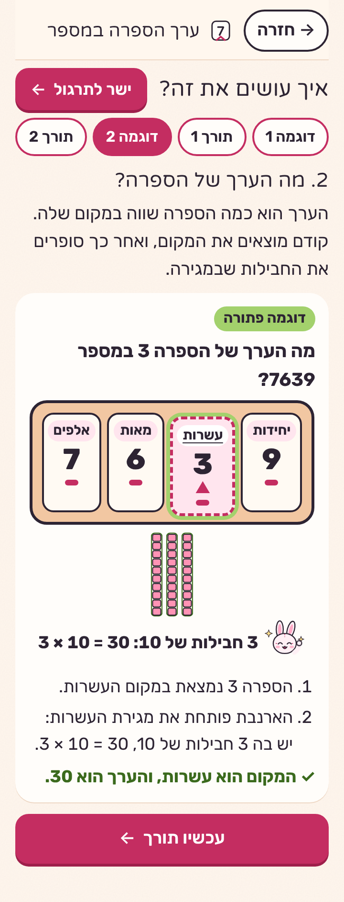
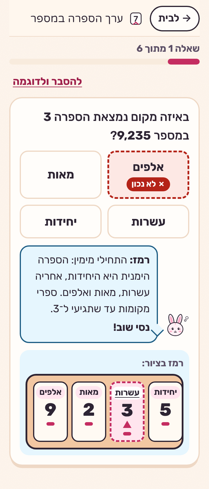
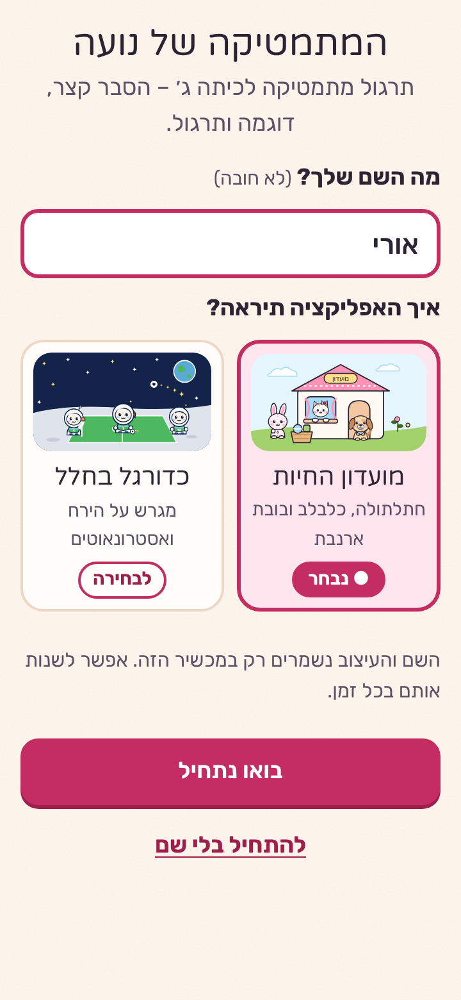
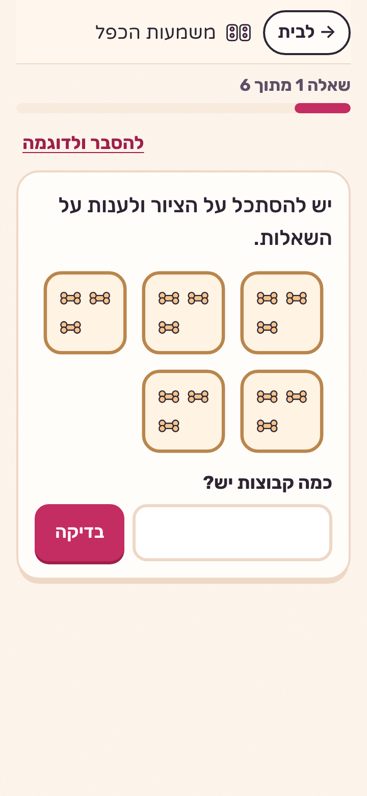
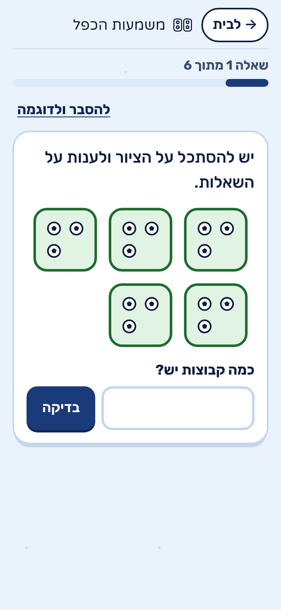

# המתמטיקה של נועה

אפליקציית תרגול במתמטיקה לכיתה ג׳, לקראת המבחן ביום חמישי, 3.12.2026.
האפליקציה בנויה לתרגול עצמאי בטלפון (נבדקה ברוחב 360px ו־390px), בעברית, עם הוראות שמתאימות לכל ילדי הכיתה.
אין בה חשבון משתמש, שרת או טיימר. השם, העיצוב וההתקדמות נשמרים בזיכרון של הדפדפן (`localStorage`).

**קישור לאפליקציה:** https://fortestudio26.github.io/noa-math/

## הפעלה

```bash
npm install
npm run dev        # שרת פיתוח, גם ברשת המקומית: http://<כתובת-המחשב>:5173
npm run build      # בדיקת TypeScript ובנייה לתיקייה dist/
npm run preview    # הגשת dist/ בכתובת http://localhost:4173
npm test           # בדיקות יחידה (Vitest)
npm run e2e        # בדיקה בדפדפן אמיתי ברוחב טלפון (צריך build קודם)
```

**פרסום:** כל דחיפה ל־`main` מריצה את הבדיקות, בונה את האפליקציה ומפרסמת אותה ב־GitHub Pages ([`.github/workflows/pages.yml`](.github/workflows/pages.yml)).
כדי שזה יעבוד, ב־Settings ← Pages צריך לבחור ב־Source את האפשרות **GitHub Actions** (פעם אחת).
הבנייה משתמשת בנתיבים יחסיים (`base: './'`), ולכן היא עובדת גם מתוך תת־תיקייה.
אפשרות אחרת: להריץ `npm run dev` במחשב ולפתוח את הכתובת מהטלפון כששניהם באותה רשת Wi‑Fi.
בדפדפן של סמסונג או בכרום אפשר לבחור ״הוספה למסך הבית״, והאפליקציה תיפתח כמו אפליקציה רגילה.

## מה יש באפליקציה

- **מסך פתיחה:** הכותרת ״המתמטיקה של נועה״, ספירה לאחור למבחן ושלוש דרכי התרגול.
  אם נשאר סבב פתוח, מופיע כפתור ״להמשיך מאיפה שעצרת״, וגם כפתור להמשך המבחן לדוגמה.
- **כרטיס ״איך עושים את זה?״ לכל נושא:**
  - הסבר של עד שלושה משפטים.
  - דוגמה פתורה בשניים־שלושה צעדים.
  - בישר המספרים, במשמעות הכפל ובגיאומטריה יש איור, ובו מסומן בדיוק על מה להסתכל: קשתות קפיצה, חץ בטבלת המקומות, מספור קבוצות, פינת דף מקווקוות, צלעות ממוספרות, אורכים מודגשים וסימוני שוויון.
  - שאלת ״עכשיו תורך״ עם נתונים אחרים: רמז ממוקד, ניסיון נוסף, ואם צריך פתרון מוסבר.
  - בנושאים עם שתי מיומנויות יש דוגמה ותרגול לכל מיומנות: כפל/חילוק, עוקב/קודם, פירוק/הרכבה, וגורם חסר בכפל/השלמה בחילוק.
  - הכפתור ״ישר לתרגול״ מופיע כבר בראש הכרטיס.
- **תרגול לפי נושא:**
  - 6 שאלות, מהקלות למאתגרות (רמות 1, 1, 2, 2, 3, 3), שאלה אחת בכל מסך, ומעליהן ״שאלה 3 מתוך 6״.
  - אחרי טעות ראשונה מופיע רמז והזדמנות לנסות שוב. אחרי טעות שנייה מוצגת התשובה הנכונה ופתרון מוסבר.
  - הכפתור ״להסבר ולדוגמה״ פותח את הכרטיס, וחוזר בדיוק לאותה שאלה.
- **תרגול מעורב:**
  - 8 שאלות, לפחות 2 בגיאומטריה ולפחות 3 בחשבון.
  - נושאים שבהם נועה טעתה (בתרגול או במבחן) מקבלים עדיפות, ונושא חלש יכול להופיע פעמיים. תמיד יש גם שאלות מנושאים אחרים.
  - כפתור ״להסבר״ זמין בכל שאלה.
- **מבחן לדוגמה:**
  - 21 שאלות שמכסות את כל 13 סעיפי המורה. סעיפים מרכזיים מופיעים פעמיים.
  - אפשר לעבור בין השאלות בכפתורים הממוספרים ולתקן תשובות.
  - אין רמזים או פתרונות עד ההגשה, ולפני ההגשה יש אישור.
  - בסוף מוצגת תוצאה לפי נושא. ליד נושא עם טעויות יש ״תרגול נוסף״, וליד כל נושא קישור ״הסבר״. יש גם מסך פתרונות מלא.
- **סוגי שאלות:** רק לחיצות – כפתורי תשובה (גם לתשובות מספריות), בחירה מתוך איורים, ופירוק בארבע שורות שממלאים בכפתורי ספרות שעל המסך. אין צורך במקלדת של הטלפון.
  בבעיות מילוליות נועה בוחרת קודם את התרגיל המתאים, ואחר כך כותבת את התשובה.
- **כיוון:** הממשק מימין לשמאל.
  כל תרגיל חשבון, סדרה, ישר מספרים וטבלת מקומות מוצג משמאל לימין, וזה נבדק בדפדפן לפי מיקום התווים.
  ביטויים בתוך משפטים בעברית עטופים ב־`<span dir="ltr">` מבודד, כדי ש־`6 × 7 = 42` לא יתהפך.
- **סימונים שלא תלויים רק בצבע:**
  - זווית ישרה מסומנת בריבוע, ושאר הזוויות בקשת כפולה.
  - צלעות שוות מסומנות בקו קטן, והאורכים כתובים עליהן.
  - המקום החסר מסומן בתיבה מקווקוות עם ״?״.
  - תשובה נכונה מסומנת ב־✓ ותשובה שגויה ב־✗.
- **גיוון:** השאלות נוצרות אוטומטית. 80 השאלות האחרונות נשמרות כדי לא לחזור עליהן בסבב הבא.

## עיצוב: מועדון החיות של נועה

השם הראשי נשאר ״המתמטיקה של נועה״. כל האיורים מקוריים, מצוירים ב־SVG בקוד ([`src/club.ts`](src/club.ts), [`src/art.ts`](src/art.ts)), בסגנון קוואי רך עם קווי מתאר כהים.

- **הדמויות.** חתלתולה עם סרט, כלבלב עם בנדנה ובובת ארנבת עם אוזניים רכות ותפרים. לכל אחת הבעות: שמחה, ״יש!״, חושבת ו״אופס״.
  - **בדף הבית** יש סצנה של מועדון קטן: החתלתולה מציצה מהחלון, הכלבלב מחכה בכניסה והארנבת יושבת ליד סל המשחקים. מתחת לסצנה יש שלושה כפתורים ברורים, אחד לכל דרך תרגול.
  - **במסכי השאלות** הדמויות קטנות. הארנבת חושבת ליד הרמז. אחרי תשובה נכונה הכלבלב מכשכש בזנב או החתלתולה מרימה כפה, וגם הודעה כתובה מופיעה.
- **צבעוניות.** רקע שמנת עם מרקם נייר עדין, ורוד תות לכפתורי הפעולה, ירוק פיסטוק ותכלת בהיר, וטקסט כהה.
  - נכון, לא נכון ונבחר מסומנים גם במילה וסימן (״✓ נכון״, ״✗ לא נכון״, ״● נבחר״), ולא רק בצבע.
  - האימוג׳ים הוחלפו באייקונים מצוירים לכל נושא. הכותרות קטנות יותר, והפריסה בלי מסגרות בתוך מסגרות.
- **האיורים בתרגילים:**
  - **מבנה עשרוני וערך הספרה:** שידת מגירות עם התוויות אלפים, מאות, עשרות ויחידות. בדוגמה הפתורה, לחיצה על מגירת העשרות פותחת אותה, והארנבת מראה 3 חבילות של 10 ואת `3 × 10 = 30`.
  - **כפל וחילוק:** הכלבלב מחלק חטיפים לקערות בכמויות שוות. בתרגול האיור מופיע רק כרמז או אחרי הבדיקה. במשמעות הכפל סופרים חטיפים בסלים.
  - **ישר המספרים:** שביל עם אבני דריכה במרווחים שווים, והחתלתולה יושבת על האבן הראשונה שיש עליה מספר. קשתות הקפיצה מופיעות רק בדוגמה.
  - **גיאומטריה:** הצורות מוצגות כחלקי פאזל. הצלעות, סימוני השוויון, אורכי הצלעות וסימוני הזוויות נשארו מדויקים.
- **בחירה במקום הקלדה.** בכל שאלה שהתשובה לה היא מילה, נועה בוחרת בכפתור: מקום הספרה, זוגי ואי־זוגי, סוג זווית, שם מצולע וסוג משולש.
  - מוצגות רק אפשרויות הגיוניות. למשל, במספר בן שלוש ספרות יש שלושה מקומות, והערכים לבחירה הם 7, 70 ו־700.
  - שמות המונחים מופיעים בסדר קבוע והגיוני. התשובה הנכונה אף פעם לא נמצאת באותו מקום בשתי שאלות בחירה רצופות.
- **הסבר לפני תרגול.** הכרטיס ״איך עושים את זה?״ מחולק לשלבים: ״דוגמה״ ואחריה ״תורך״, לכל מיומנות. כך נועה עונה בלי לגלול דרך מסך ארוך.
  - ״ישר לתרגול״ זמין בכל שלב.
  - מתוך התרגול, ״להסבר ולדוגמה״ פותח את הכרטיס, וממנו אפשר לחזור לאותה שאלה.
- **פירוק בארבע שורות.** ״פרקי את המספר 7639״ עם ארבעה שדות מספריים.
  - שורה ריקה מסומנת ״○ השורה ריקה״, ושורה עם ספרה לא נכונה מסומנת ״✗ לתיקון״. אלה שני מצבים שונים.
  - מה שנועה כבר מילאה נשאר אחרי הבדיקה. אחרי הפתרון מוצג הפירוק לפי ערכים: `7,000 + 600 + 30 + 9`.

## בלי מקלדת של הטלפון

בחלק מהטלפונים המקלדת לא נפתחה בתוך האפליקציה, ואי אפשר היה להמשיך. לכן אין יותר אף שדה שצריך להקליד בו:
- **כל תשובה מספרית** מוצגת כארבעה כפתורים: התשובה הנכונה ושלוש טעויות אופייניות, למשל המספר עצמו במקום העוקב, או קפיצה אחת יותר או פחות בישר המספרים.
  - הכפתורים מסודרים מהקטן לגדול, והתשובה הנכונה נמצאת כל פעם במקום אחר ([`src/choices.ts`](src/choices.ts)).
  - לשאלה מסוימת מוצגים תמיד אותם כפתורים, גם אחרי רענון.
- **בפירוק בארבע שורות** לוחצים על שורה ואז על ספרה בלוח הספרות שעל המסך. יש גם כפתור מחיקה וכפתור לשורה הבאה. שורה ריקה ושורה עם 0 עדיין נבדקות כשני מצבים שונים.
- **את השם במסך הפתיחה** בוחרים מלוח אותיות עבריות שעל המסך, עם רווח ומחיקה. השם עדיין לא חובה.
- **סבבים ומבחנים שנשמרו בגרסה קודמת** עוברים אוטומטית לכפתורים, וגם התשובות שכבר נבחרו נשמרות.

## לכל הכיתה: שם אישי ושני עיצובים

- **שם האפליקציה** נשאר ״המתמטיקה של נועה״: בכותרת, בשם הדף ובתצוגה המקדימה של הקישור (תגי `og:` ב־`index.html`).
- **בכניסה הראשונה** מופיע מסך קצר עם שדה לשם פרטי ובחירה בין שני עיצובים. לכל עיצוב יש תמונה קטנה שמראה איך הוא נראה.
  - אפשר ללחוץ ״להתחיל בלי שם״ ולהתחיל לתרגל מיד.
  - השם והעיצוב נשמרים רק בדפדפן שבמכשיר, בלי חשבון ובלי שרת.
- **בדף הבית** מופיעה ברכה כמו ״היי, אורי!״ מתחת לשם האפליקציה, וקישור ״שינוי שם ועיצוב״.
  - החלפת עיצוב או עריכת שם לא משנות את ההתקדמות, את הסבב הפתוח או את המבחן.
- **ילדים שכבר תרגלו** בגרסה הקודמת לא רואים את מסך הפתיחה. הם מקבלים את ״מועדון החיות״ וההתקדמות שלהם נשמרת.
- **ההוראות מנוסחות לכל הכיתה,** בלי פנייה בלשון נקבה: ״יש לבחור את הזווית הישרה״, ״מה המספר החסר?״, ״מתחילים מימין…״, ״אפשר לנסות שוב!״.
- **״מועדון החיות״** הוא העיצוב הקודם: חתלתולה, כלבלב, בובת ארנבת, שמנת וורוד תות.
- **״כדורגל בחלל״** הוא עיצוב חדש: מגרש כדורגל על הירח ושלושה אסטרונאוטים במדי קבוצה. החלוצה עם הכדור במקום החתלתולה, השוער עם הכפפות במקום הכלבלב, והקפטנית עם סרט הקפטן במקום הארנבת. יש גם כדור עם שובל של כוכבים.
  - הצבעים: כחול לילה לכפתורים, תכלת וירוק מגרש, ואזורים בהירים לתרגילים.
  - בכפל ובחילוק מופיעים כדורים בשקים בקבוצות שוות. בישר המספרים יש סימונים על המגרש במרווחים שווים. בשאלות על מקום הספרה יש ארוניות בחדר ההלבשה.
- **איך זה בנוי:** שני העיצובים משתמשים באותו קוד ובאותם תרגילים.
  - מילים שתלויות בעיצוב (״חטיפים״ או ״כדורים״, ״מגירה״ או ״ארונית״) נכתבות כ־`{{token}}` ומתחלפות כשהמסך מוצג ([`src/theme.ts`](src/theme.ts)). לכן אפשר להחליף עיצוב גם באמצע שאלה.
  - כל דמות וכל איור נבנים בשתי הגרסאות, וה־CSS מציג את הגרסה של העיצוב שנבחר.

## מקורות: מה נפתח בפועל ומה אומת

**חשוב:** סביבת העבודה הזאת חסמה גישה ישירה לאתרים הרלוונטיים.
הפרוקסי החזיר שגיאה 403 עבור `ecat.education.gov.il`, `bonusbooks-shop.co.il`, `matmonplus.co.il`, `pop.education.gov.il` ו־`meyda.education.gov.il`.
לכן **לא** ראיתי כריכה, תוכן עניינים או עמודים לדוגמה מהחוברת.
כל המידע למטה מגיע מתוצאות חיפוש ברשת (כותרות ותקצירים של העמודים), ולא מקריאת העמודים עצמם.

| מקור (מתוך תוצאות החיפוש) | מה היה נגיש |
|---|---|
| הקטלוג החינוכי של משרד החינוך: ״השבחה לכיתה ג׳ – מארז״ ו״השבחה לכיתה ג׳ – דיגיטלי״ (ecat.education.gov.il) | שם הסדרה; ספק: ״יבנה בונוס בע״מ – wizdi״; כותר 416‑2016 ״השבחה ג׳ – מספרים בתחום הרבבה״ וכותר 416‑2017 ״השבחה ג׳ – כפל וחילוק״; ספר מאושר |
| חנות ההוצאה יבנה (bonusbooks-shop.co.il): ארכיון הסדרה ״השבחה״, ודפי המוצר ״מספרים בתחום הרבבה״, ״כפל וחילוק״ ו״גאומטריה״ | השיטה פותחה במכון לקידום האינטגרציה (השילוב) באוניברסיטת בר־אילן. נושאי ״מספרים בתחום הרבבה״: ייצוגים של מספרים בתחום הרבבה (10,000), וחיבור וחיסור בתחום הרבבה. נושאי ״גאומטריה״: שוויון צלעות במצולעים, זוויות במצולע, צלעות מאונכות ומקבילות, מידות ומדידות, סיבוב וסימטריה סיבובית |
| matmonplus.co.il ו־ar26.co.il (חנויות) | כותרת מוצר: ״ספר השבחה 1 לכיתה ג מספרים בתחום הרבבה״ |
| פורטל פדגוגיה של משרד החינוך, יחידת ״זוויות / מצולעים״ לכיתה ג׳ | ביחידה ״נעסוק ב־4 סוגי זוויות: שטוחה, קהה, ישרה וחדה״, וזיהוי זוויות במצולעים |
| אוניברסיטת חיפה, משימות הערכה בגיאומטריה (ymath.haifa.ac.il) | סוגי זוויות נלמדים מכיתה ג׳. תלמידים נוטים לבלבל בין זווית קהה לשטוחה |

**מה אומת (מהתקצירים בלבד):**
- ״השבחה לכיתה ג׳״ היא סדרה של הוצאת יבנה, שפותחה בבר־אילן.
- הכרך ״השבחה 1״ לכיתה ג׳ הוא ״מספרים בתחום הרבבה״, ולכן הטווח המספרי באפליקציה הוא עד 10,000.
- כפל וחילוק וגיאומטריה נמצאים בכרכים **נפרדים** מחלק 1. לכן הם נבנו לפי רשימת המורה, כמו שביקשת.

**מה לא אומת:**
- מספרי עמודים.
- סוגי התרגילים, ניסוח ההוראות והקצב בחוברת עצמה.
- איזו מהדורה בשימוש.
- האם ״חלק 1״ אצל המורה זה בדיוק הכרך הזה. זו מסקנה שלי מכותרת המוצר ״השבחה 1״ ומסדר מספרי הכותרים.

**עמודים מצורפים:** לא נמצאו בפרויקט עמודים מהחוברת או תמונות מהמחברת. בריפו יש רק `index.html` של אתר אחר.

### מה כדאי לדייק כשיצורפו עמודים מהחוברת או מהמחברת
1. **סימון חילוק וכתיבת מספרים:** האפליקציה משתמשת ב־`:` לחילוק וב־`×` לכפל, ומספרים בני 4 ספרות נכתבים עם פסיק (3,406). אם בחוברת כותבים אחרת, משנים את זה ב־`config.ts`.
2. **סדר הגורמים בכפל:** האפליקציה מתייחסת ל־`3 × 4` כאל ״3 קבוצות של 4״.
   כדי שלא תהיה תשובה שנויה במחלוקת, התרגיל ההפוך (`4 × 3`) לא מוצג אף פעם כמסיח.
   כדאי לבדוק איך מלמדים את זה בכיתה.
3. **זווית שטוחה:** כבויה כברירת מחדל, כי היא לא ברשימת המורה ולא אומתה בפרק. אם היא נלמדת, משנים ל־`includeStraightAngle: true`.
4. **משולש שווה־צלעות ושווה־שוקיים:** ברירת המחדל היא ההגדרה המכילה (שווה־צלעות הוא גם שווה־שוקיים).
   לכן בשאלות בחירה יחידה לא מוצעת ״שווה־שוקיים״ ליד משולש שווה־צלעות.
   גם בשאלה ״בחרי את המשולש שווה־השוקיים״ לא מופיע משולש שווה־צלעות.
   אם במחברת ההגדרה בלעדית, אפשר לשנות את `equilateralCountsAsIsosceles`.
5. **שמות המצולעים:** משולש, מרובע, מחומש, משושה, מתומן. אם לומדים גם משובע, מוסיפים `7: 'משובע'`.
6. **היקף לוח הכפל:** עד 10×10.
7. **סוגי שאלות וקצב:** יש להתאים אותם לעמודים, למשל סוג הסדרות, גודל הקפיצות בישר המספרים וניסוח הבעיות המילוליות.

## ברירות מחדל: הכול במקום אחד

כל ההגדרות נמצאות ב־[`src/config.ts`](src/config.ts):

| הגדרה | ערך | הערה |
|---|---|---|
| `maxNumber` | 10000 | ״מספרים בתחום הרבבה״ |
| `timesTableMax` | 10 | לוח הכפל 1–10 |
| `minDivisor` | 2 | אין חילוק ב־0 (וגם לא ב־1 בשאלות חילוק) |
| `thousandsSeparator` | `,` | 3,406 |
| `multSymbol` / `divSymbol` | `×` / `:` | |
| `polygonNames` | 3–6, 8 | |
| `includeStraightAngle` | false | |
| `equilateralCountsAsIsosceles` | true | |
| `topicRoundLevels` | [1,1,2,2,3,3] | 6 שאלות בסבב |
| `mixedLength` | 8 | |

את תוכנית המבחן לדוגמה (איזה נושא, כמה פעמים ובאיזו רמה) אפשר לשנות ב־`EXAM_PLAN` שבקובץ [`src/rounds.ts`](src/rounds.ts).

## כיסוי נושאי המורה

| נושא | מה מתרגלים (רמות 1→3) |
|---|---|
| מבנה עשרוני | הרכבה מסכום, השלמת פירוק, מספרים עם 0, תיאור במילים בסדר מבולבל, בחירת הפירוק הנכון |
| ערך הספרה | ערך ספרה, באיזה מקום היא נמצאת (במספר עם 0), ספרה שמופיעה פעמיים (״ה־4 שבמקום המאות״), ״באיזה מספר 6 שווה 600?״ |
| קודם ועוקב | בלי מעבר, עם מעבר עשרת או מאה, עם מעבר אלף (4,999 ← 5,000), ״המספר שבין...״ |
| זוגי ואי־זוגי | זוגי או אי־זוגי, בחירת המספר הזוגי או האי־זוגי, הזוגי או האי־זוגי הבא |
| כפל וחילוק | לוח הכפל, חילוק כהפוך לכפל, משפחת תרגילים, בחירת תרגיל חילוק נכון לפי תרגיל כפל |
| מספר חסר | המקום החסר משתנה: `☐ × 8`, `6 × ☐`, `☐ : 5`, `36 : ☐`, וגם חיבור וחיסור |
| ישר המספרים | ישר עם שנתות ברווחים שווים. קפיצות של 1–1000. מספרים כתובים על שנתות סמוכות או רחוקות. ״?״ לפני או אחרי |
| סדרות | עולות ויורדות, החסר בהתחלה, באמצע או בסוף, כולל מעבר אלף |
| משמעות הכפל | כמה קבוצות, כמה בכל קבוצה ובסך הכל; איזה תרגיל מתאים לציור; איזה ציור מתאים לתרגיל (עם מסיח של קבוצות לא שוות) |
| בעיות מילוליות | בחירת תרגיל ואז התשובה: חיבור, חיסור, כפל, ״פי״, חלוקה שווה בשווה וחלוקה לקבוצות |
| סוגי זוויות | חדה, ישרה וקהה בכל כיוון; בחירה מתוך איורים; זווית מסומנת בתוך משולש |
| מצולעים | ספירת צלעות וקודקודים, שם המצולע, בחירת מצולע לפי שם, ״איזו צורה אינה מצולע?״. גדלים וכיוונים משתנים |
| מיון משולשים | איור מדויק בקנה מידה, עם אורכים וסימוני שוויון; אורכים בטקסט בלבד; בחירת המשולש המתאים מתוך איורים |

## בדיקות

**בדיקות יחידה (`npm test`, Vitest): 45 בדיקות עברו.**
- בסבבים, בתרגול מעורב, במבחנים ובכרטיסי ההסבר אין אף שאלה שדורשת הקלדה.
- בכפתורי המספרים יש ארבעה מספרים שלמים ושונים, מהקטן לגדול, ורק אחד מהם נכון.
- אין פנייה בלשון נקבה בתוכן.
- כל מילה שתלויה בעיצוב מתחלפת נכון בשני העיצובים.
- כל דמות מצוירת בשתי הגרסאות.
- אין שאלה שדורשת להקליד מילה.
- מונחים מופיעים כבחירה בסדר קבוע, והתשובה הנכונה לא באותו מקום בשתי שאלות רצופות.
- אין מילים מעולם החלל ואין אימוג׳ים.
- בסצנת הבית מופיעות שלוש הדמויות.
בנוסף לבדיקות שלמטה:
- תשובות בעברית (״עשרות״, ״עֲשָׂרוֹת״, ״שלושים״, ״3 עשרות״) והרמז ״מצאת את המקום״.
- פירוק 7639 ו־7052: סימון השורה הלא נכונה, ורמז כשהאפס חסר.
- 4 אפשרויות שונות בשאלות בחירה, והתשובה הנכונה בכל אחד מארבעת המקומות.
- 150 סבבים לכל נושא: אותו מספר מופיע כמה פעמים, אבל אף פעם לא בשתי שאלות רצופות.

הבדיקות שהיו כבר בגרסה הקודמת:
- ייצור של כ־15,600 שאלות (400 לכל נושא ולכל רמה). כולן עוברות ולידציה:
  - יש תשובה, והיא אחת מאפשרויות הבחירה.
  - אין מסיחים כפולים (לא בטקסט ולא באיור).
  - אין חילוק ב־0, ואין `NaN` או `undefined`.
  - כל המספרים עד 10,000.
- כל תרגיל עם חסר מחושב מחדש, ושני צדי המשוואה שווים.
- ישר המספרים: השנתות ברווחים שווים, והתשובה תואמת את המספרים שעל השנתות.
- סדרות: הקפיצה קבועה.
- משולשים:
  - הסיווג תואם את האורכים.
  - בבחירה יחידה לעולם אין שתי תשובות נכונות.
  - בבחירה מתוך איורים בדיוק איור אחד מתאים.
- זוויות: לזווית ישרה יש סימון ריבוע ולאחרות קשת.
- מצולעים: מספר הקודקודים המצוירים שווה לתשובה.
- סבבים:
  - בתרגול לפי נושא יש 6 שאלות מהקל לקשה, בלי חזרות על הסבב הקודם.
  - המבחן מכסה את 13 הנושאים.
  - התרגול המעורב משלב חשבון וגיאומטריה, ונושא חלש מופיע בו בממוצע פעמיים.
- כרטיסי ההסבר:
  - יש כרטיס לכל נושא, עם הסבר של עד 3 משפטים, דוגמה של 2–3 צעדים, ושאלת ״עכשיו תורך״ תקינה עם נתונים אחרים.
  - שאלת ״עכשיו תורך״ בודקת את אותה מיומנות שבדוגמה, כולל בנושאים עם שתי מיומנויות.

**בדיקה בדפדפן (`npm run e2e`, Playwright, 360×760 ו־390×844 עם מגע): 208 בדיקות עברו, 0 נכשלו.**
- בכל 136 המסכים שנבדקו ב־390px אין אף שדה טקסט שפותח את המקלדת של הטלפון.
- השם מוזן מלוח האותיות, והפירוק נעשה בלוח הספרות.
- כניסה ראשונה מקישור חדש: עם שם (״היי, אורי!״), בלי שם, ומשתמשת קיימת שההתקדמות שלה נשמרה.
- החלפת עיצוב באמצע תרגול: אותה שאלה ואותה תשובה נשמרות, גם אחרי רענון. גם תשובה במבחן נשמרת אחרי החלפת עיצוב.
- ב־390px עם ״כדורגל בחלל״ עברו 136 מסכים בלי גלילה אופקית.
- כל כרטיס הסבר מוצג בשני מסכים נפרדים: דוגמה, ואחריה ״עכשיו תורך״.
- שאלת מקום הספרה מוצגת עם כפתורים ובלי שדה טקסט. בחירה לא נכונה מסומנת ״לא נכון״ ומקבלת רמז.
- בפירוק 7052 שורה ריקה ושורה שגויה מקבלות סימון שונה, וההשלמה עם 0 מתקבלת.
- שאלת גיאומטריה בתרגול נבדקה מתחילתה ועד סופה.
- ברוחב 390px עברו 136 מסכים בלי גלילה אופקית: כל שלבי ההסבר, 13 סבבים, מבחן, תוצאות ופתרונות.
בנוסף לבדיקות שלמטה:
- לחיצה על התא של 3 עשרות מציגה 3 חבילות.
- תאי המטען מסודרים 7‑6‑3‑9 משמאל לימין.
- בפירוק 7052 עם שורה ריקה מסומנת רק שורת המאות, הערכים שכבר מולאו נשמרים, ואפשר להשלים עם 0.
- הפירוק לפי ערכים מוצג משמאל לימין.
- סבב מלא של מבנה עשרוני.
- במבחן, שאלת פירוק נשמרת אחרי רענון.

הבדיקות שהיו כבר בגרסה הקודמת:
- כל 13 הכרטיסים נפתחים, ובכל אחד יש ״ישר לתרגול״, דוגמה פתורה ו״עכשיו תורך״.
- ״עכשיו תורך״ בערך הספרה: אחרי טעות מופיע הרמז ״התחילי מימין...״, ואחרי תיקון התשובה 70 מתקבלת.
- סבב שלם של ישר המספרים:
  - השנתות ברווחים שווים, והמספרים עולים משמאל לימין.
  - אחרי טעות מופיע הרמז ״בדקי בכמה המספרים גדלים בין שתי שנתות״, והתשובה הנכונה מתקבלת אחרי הרמז (גם כשהיא נכתבת עם פסיק).
  - אחרי שתי טעויות מוצגים התשובה והפתרון המוסבר.
  - ״להסבר ולדוגמה״ חוזר לשאלה 3.
  - **אחרי רענון הדף ההתקדמות נשמרת** (שאלה 4 מתוך 6), ובמסך הבית מופיע ״להמשיך מאיפה שעצרת״. משם ממשיכים עד הסיכום.
- סדר התצוגה: תרגיל עם חסר מוצג משמאל לימין, כולל ביטויים בתוך הסברים בעברית, וגם תיבות הסדרה.
- תרגול מעורב שלם (8 שאלות) עם חשבון וגיאומטריה.
- **מבחן לדוגמה עד מסך התוצאות:**
  - 21 שאלות, כל 13 הנושאים, בלי רמזים או פתרונות לפני ההגשה.
  - אפשר לחזור לשאלה 1 ולשנות תשובה, והתשובה נשמרת אחרי רענון.
  - לפני ההגשה יש אישור. אחרי ההגשה מוצגות 13 שורות לפי נושא, והציון הוא 20 מתוך 21 (בכוונה טעות אחת).
  - ״תרגול נוסף״ מופיע רק ליד הנושא עם הטעות. בכל השורות יש קישורי ״הסבר״, ויש מסך פתרונות.
  - ״תרגול נוסף״ פותח סבב בנושא.
- סריקת פריסה: 156 שאלות (2 סבבים × 13 נושאים). אף אחת לא גורמת לגלילה אופקית ברוחב 360px.
- אין שגיאות JavaScript בקונסול.

צילומי מסך מהגרסה הנוכחית (360px, ברזולוציה כפולה):

| דף הבית | דוגמה פתורה (מגירת העשרות פתוחה) | שאלה עם תשובות לבחירה |
|---|---|---|
|  |  |  |

| בחירת שם ועיצוב | אותה שאלה – מועדון החיות | אותה שאלה – כדורגל בחלל |
|---|---|---|
|  |  |  |

## מבנה הקוד

```
src/config.ts          כל ההגדרות שאפשר לשנות
src/topics.ts          13 הנושאים של המורה
src/generators/        יוצרי השאלות (numbers.ts, geometry.ts, place.ts – מבנה עשרוני וערך הספרה)
src/answers.ts         בדיקת תשובות: מספרים, מילים בעברית ופירוק בכמה שדות
src/club.ts            הדמויות (חתלתולה, כלבלב, ארנבת), שידת המגירות, החבילות והקערות
src/art.ts             סצנות הבית (מועדון / מגרש על הירח) ואייקוני הנושאים
src/theme.ts           שני העיצובים והמילים שמתחלפות לפי עיצוב
src/figures.ts         ציורים מדויקים ב־SVG: ישר מספרים, זוויות, מצולעים, משולשים בקנה מידה, קבוצות, סדרות וטבלת מקומות
src/lessons.ts         כרטיסי ״איך עושים את זה?״
src/rounds.ts          בניית סבבים (נושא, מעורב, מבחן) ובדיקת תשובות
src/validate.ts        ולידציה לכל שאלה לפני שהיא מוצגת
src/app.ts             הממשק, השמירה והניווט
tests/                 בדיקות יחידה
e2e/run-e2e.mjs        בדיקה בדפדפן
```
